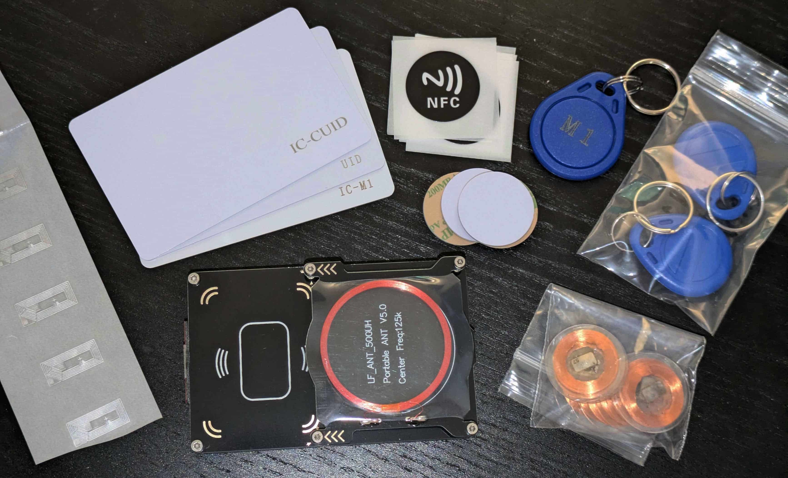

# proxmark3easy-tools

This is my personal repository for my **Proxmark3 Easy (512KB)** firmware, automation scripts, and notes.

I was sick of not using my Proxmark3 for a few months and then forgetting everything I had learned. This is designed so that after months of inactivity, or when wanting to use my PM3 on a new machine, I can quickly and easily test, flash firmware, and launch the client.



---

## Hardware

| Specification | Hardware Value |
| :--- | :--- |
| **Model** | Proxmark3 Easy ([from AliExpress](https://www.aliexpress.us/item/3256806808357515.html) for $24 in Jan 2025) |
| **Microcontroller (MCU)** | Atmel AT91SAM7S512 Rev A (ARM7TDMI) |
| **Internal Flash Memory** | 512 KB |
| **Internal SRAM** | 64 KB |
| **External SPI Flash** | 2048 Kb (32 pages x 64 KB), JEDEC ID: `85 / 6015` |
| **USB Hardware ID** | `VID: 9AC4`, `PID: 4B8F` |
| **WSL Device Node** | `/dev/pm3-0` -> `/dev/ttyACM0` |

---

## Current Flashed Firmware

- **Compilation & Flash Date:** October 23, 2026
- **Upstream Branch/Tag:** `Iceman/master/v4.23346-209-gc10930d6e`
- **Upstream Commit:** [`c10930d6e`](https://github.com/RfidResearchGroup/proxmark3/commit/c10930d6e)
- **Toolchains:** `arm-none-eabi-gcc 13.2.1 20231009`, Host `GCC 13.3.0`
- **Configuration File:** [`firmware/Makefile.platform`](./firmware/Makefile.platform)

```makefile
PLATFORM=PM3GENERIC
PLATFORM_EXTRAS=FLASH
LED_ORDER=PM3EASY
STANDALONE=LF_SAMYRUN
```

### Config Notes:
- **`PLATFORM_EXTRAS=FLASH`**: My PM3 has onboard SPI flash memory. Without `PLATFORM_EXTRAS=FLASH`, the firmware cannot use the external flash for emulation memory, which causes commands like `hf mfu eload` and `hf mfu eview` to silently fail.
- **`LED_ORDER=PM3EASY`**: The Proxmark3 Easy PCB routes LEDs in a different sequence than the RDV4. `PM3EASY` aligns the firmware LED driver with the silkscreen on the board.
- **`STANDALONE=LF_SAMYRUN`**: Samy Kamkar's HID26 read/clone/sim standalone mode. Fits within the 512KB flash (89% total image).

Full build info and hardware outputs are archived in [`firmware/FIRMWARE_INFO.md`](./firmware/FIRMWARE_INFO.md).

---

## Quick Start

Windows batch files are located in the repo root:

| Script | Purpose |
| :--- | :--- |
| **`start-pm3.bat`** | Checks USB, attaches to WSL2 via `usbipd`, updates udev, and opens the `pm3` client. |
| **`check-hardware.bat`** | Runs `hw version`, `hw status`, `hw ping`, `hw tune` to check LF/HF antennas and flash. |
| **`detect-device.bat`** | Check COM port assignment, Windows PnP status, and USBIPD state. |
| **`flash-firmware.bat`** | Flashes the repos bundled [`firmware/bootrom.elf`](./firmware/bootrom.elf) and [`firmware/fullimage.elf`](./firmware/fullimage.elf). |

---

## Windows Setup

1. **Clone the repo:**
   ```powershell
   git clone https://github.com/jwidess/proxmark3easy-tools.git
   cd proxmark3easy-tools
   ```

2. **Plug in the PM3**

3. **Run the environment setup:**
   ```powershell
   .\scripts\setup-wsl-environment.ps1
   ```
   *This automatically installs `usbipd` (via winget if needed), installs all required Ubuntu packages, and configures udev permissions.*

4. **Verify and Flash:**
   - Run `.\detect-device.bat` to confirm your device is detected.
   - Run `.\flash-firmware.bat` to flash the precompiled firmware.
   - Run `.\start-pm3.bat`

---

## Repo Structure

```text
proxmark3easy-tools/
├── README.md
├── start-pm3.bat
├── check-hardware.bat
├── detect-device.bat
├── flash-firmware.bat
├── firmware/
│   ├── FIRMWARE_INFO.md
│   ├── Makefile.platform
│   ├── bootrom.elf / .bin
│   ├── fullimage.elf / .bin
│   └── recovery.bin
└── scripts/
    ├── start-pm3.ps1
    ├── detect-device.ps1
    ├── flash-firmware.ps1 / .sh
    ├── check-hardware.ps1 / .sh
    ├── setup-wsl-environment.ps1
    └── button-trick-guide.md
```

---

## Cheat Sheet

For use in the interactive `pm3` client:

### Diagnostics & Tuning
```text
hw version           # Display client, firmware, FPGA, MCU, and compiler versions
hw status            # Show memory allocation, SPI flash status, and active configs
hw ping              # Test round-trip latency to device
hw tune              # Measure LF (125 kHz) and HF (13.56 MHz) antenna voltages
mem spiffs info      # Inspect external SPI flash filesystem
hf tune              # Measure HF antenna voltage and quality factor
lf tune              # Measure LF antenna voltage and quality factor
```

### MIFARE Ultralight (MFU)
```text
hf mfu dump                 # Read all blocks and save to a dump file
hf mfu eload -f <file.bin>  # Load dump file into emulator memory (requires FLASH mod)
hf mfu eview                # View loaded card data in emulator memory
hf mfu sim -t 2             # Emulate MIFARE Ultralight tag
```

### Low Frequency (125 kHz)
```text
lf search            # Automatically detect and read unknown LF tag
lf t55xx detect      # Detect Atmel T55x7 rewritable tag
lf t55xx dump        # Dump T55xx chip blocks
lf hid read          # Read HID Prox card
lf hid clone -r <ID> # Clone HID Prox credential to T55xx
```

### High Frequency (13.56 MHz)
```text
hf search            # Automatically detect and read unknown HF tag
hf 14a info          # Show ISO 14443-A UID, ATQA, and SAK
hf 14a reader        # Read data from 14a tag
hf mf autopwn        # Automated nested/hardnested key recovery for MIFARE Classic
```

---

## Unbricking

If the device ever gets interrupted during a flash or fails to boot:

1. Unplug the PM3.
2. **Press and hold the button** on the board.
3. While holding the button, plug the USB cable into your computer.
4. Release the button once two LEDs remain lit.
5. Run `.\flash-firmware.bat` (or add `--force` in terminal).

See [`scripts/button-trick-guide.md`](./scripts/button-trick-guide.md) for more info.
